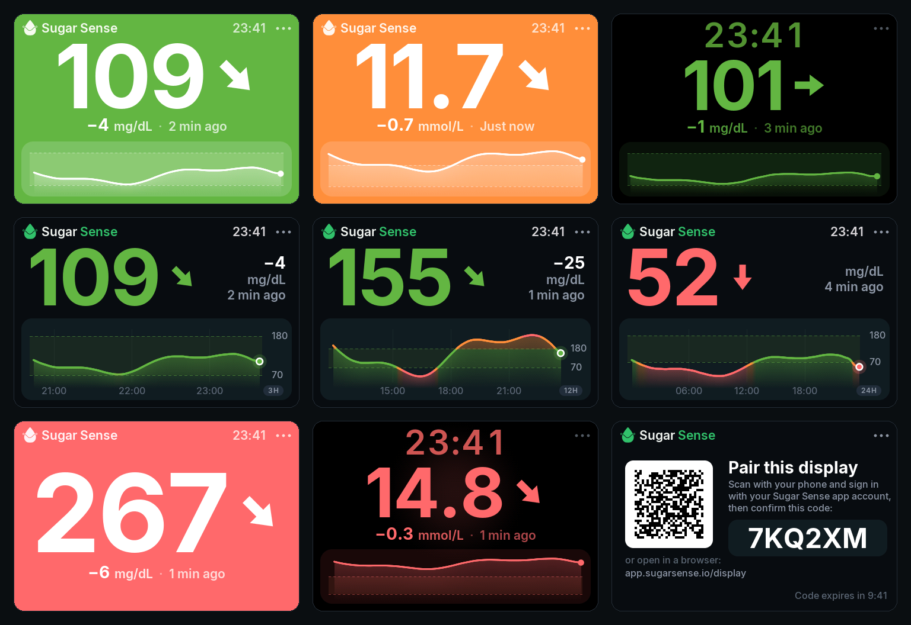

# Sugar Sense Display

Your glucose at a glance, on a small touchscreen that costs about 25 dollars.

It is a free second screen for the readings you already have in the
[Sugar Sense](https://sugarsense.io) app, in the app's own look: the number in
its zone color, the trend arrow, the change, the age of the reading, and the
graph (a smooth line colored by zone over the target range). At night it turns
into a black bedside clock with the number under it. If you like it loud, one
setting paints the whole screen in the zone color; if you like it quiet,
another hides the graph and leaves the number alone. If you follow people in
the app's Care Circle, the screen can show them too, up to four at once.



> **Not a medical device.** The display shows readings that come from your
> sensor through the Sugar Sense app's servers. They can be delayed, missing or
> wrong. It never alerts. Treatment decisions belong on your phone and your
> sensor's own app, never on this screen.

## What you need

- A **Guition JC3248W535** board: an ESP32-S3 with a 3.5 inch 320x480 touch
  screen, sold on AliExpress for about 20 to 30 dollars. Any USB-C charger
  powers it.
- The **Sugar Sense app** on your phone (App Store or Google Play), signed in,
  with a glucose source connected (Libre, Dexcom, Nightscout). The display
  shows that account's glucose. The display itself is free: it needs no
  subscription.
- Wi-Fi at home.

## Install

Open **[app.sugarsense.io/install](https://app.sugarsense.io/install)** in
Chrome or Edge on a computer, plug the display in with a USB-C cable that
carries data, and click Install. It takes about a minute and needs no
software on your computer.

Updating a display that already runs Sugar Sense works the same way: leave
"Erase device" unticked and it keeps its Wi-Fi and its pairing.

## Setting it up

1. The display lists the Wi-Fi networks around it. Pick yours and type the
   password on the screen.
2. It shows a QR code. Scan it with your phone, sign in with the same Google
   or Apple account you use in the Sugar Sense app, and tap **Connect
   display**. (No camera? Open `app.sugarsense.io/display` and type the
   6-character code.)
3. A few seconds later your glucose is on the display. The clock sets itself
   to your phone's time zone and follows daylight saving changes.

From then on it asks Sugar Sense for your latest reading once a minute.

Paired it before you had the app? The display says "One more step" and shows
a QR code that takes your phone to the app. Sign in there with the account you
paired the display with, connect your sensor, and the readings start on the
display by themselves.

The display never sees your sensor password. It holds one session token that
can read your glucose snapshot and nothing else. On the network it talks to
`app.sugarsense.io`, over TLS with the certificate checked, and to the public
time servers `pool.ntp.org` and `time.google.com` for the clock; nothing else.
"Disconnect" in its Settings ends that session on the server as well.

## Using it

- **The three dots** (top right) open Settings, short pages named as tabs
  along the top (tap any; a fourth, People, while the account follows someone):
  - **Display:** brightness, the scene, the graph's window (3, 6, 12 or 24
    hours, or Off), screen rotation, sound (with the small speaker plugged into
    the board's speaker socket: a soft tick on a tap, a chime when Wi-Fi joins
    and when the display is paired).
  - **Night:** when the night starts and ends, and how dim the screen gets.
  - **System:** the time zone (Auto, or Manual with an offset you set), Wi-Fi,
    disconnect, and an Update row when a newer version is out.
- The home screen itself is for looking: a touch anywhere on it only brings the
  light up for a minute during the night hours. Nothing changes by accident.
- **Scene** picks the look. **Color**: the whole screen in the reading's zone
  color with white ink, like the app's full screen view, so the state reads
  from across the room. **Night**: black, a large clock over the number.
  **Dark**: the number, the change and the graph on a dark screen. **Auto**
  (the default) is Color by day and Night in the night hours you set.
- **Graph: Off** is for numbers only: the graph goes, the number grows and
  stands in the middle of the screen with the change and the age under it. It
  works in every scene.
- **People** (a fourth page, there when the account follows someone in the
  Care Circle): your own glucose and every person you follow, each On or Off.
  One person fills the screen as usual, with their name in the corner; two to
  four split it into tiles, each with the name, the number in its zone color,
  the arrow, the change and the age, in whichever scene is up. At least one
  stays on; a person who stops sharing shows "Not shared", a pause shows
  "Paused". The display only ever shows people who already share with that
  account in the app; nothing here grants anything.
- Past 15 minutes without a reading the screen says "No Data". It never keeps
  showing an old number as if it were current.
- **A small dot beside the three dots** means a newer version is out. Settings
  > System > Update says where to get it: the install page again, with "Erase
  device" left unticked so the display keeps its Wi-Fi and its pairing.
- **Sold or lost a display?** Open `app.sugarsense.io/display`, sign in, and
  disconnect it under "Your displays". An account can hold five displays.

## Build it from source

```sh
brew install arduino-cli esptool                 # or your platform's packages
arduino-cli core install esp32:esp32
arduino-cli lib install "GFX Library for Arduino" ArduinoJson
tools/flash.sh                                   # compile and write to the board over USB
```

Two things that can cost time on a Mac:

- **Apple Silicon without Rosetta:** arduino-cli's bundled `ctags` is an Intel
  binary and the build stops with `bad CPU type in executable`. Build the same
  version from `github.com/arduino/ctags` (tag `5.8-arduino11`; rename the
  `__unused__` macro in its sources first, it collides with the macOS headers)
  and put it at
  `~/Library/Arduino15/packages/builtin/tools/ctags/5.8-arduino11/ctags`.
- **`brew install esptool` can pull a newer Python** and relink the unversioned
  `python3`. If your scripts then miss their packages, relink the Python you
  had.

The board hangs off the ESP32-S3's native USB port: only esptool's
`--after watchdog-reset` restarts it after a flash.

To go back to the firmware the board came with, read it out before your first
flash and write it back later:

```sh
esptool --chip esp32s3 --port <PORT> read-flash 0 0x1000000 factory.bin
esptool --chip esp32s3 --port <PORT> --after watchdog-reset write-flash 0x0 factory.bin
```

## For developers

The firmware is an Arduino sketch in `firmware/sugarsense_display/`:

| File | What |
|---|---|
| `sugarsense_display.ino` | the app: boot, the home loop, the Wi-Fi picker, pairing, settings |
| `ss_logic.h` | the display rules, pure C++: zones, the 15 minute rule, mmol/L, arrows, the change |
| `gx.h` | a small anti-aliased renderer over the RGB565 framebuffer, rotation included |
| `ui.h` | every screen as a pure drawing function, plus the layouts the touch code shares |
| `hw.h` | the board: panel, touch, speaker, the USB console |
| `net.h` | Wi-Fi, the clock, the four API calls, the QR code |
| `store.h` | settings in non-volatile storage |
| `certs.h` | the trusted root certificates |
| `assets.h` | GENERATED fonts, arrows, mark and icon (`tools/gen_assets.py`) |

`ss_logic.h`, `gx.h` and `ui.h` do not depend on the board, so they compile and
run on a computer:

```sh
python3 tools/host_test.py                  # the rule tests and the change fixture
python3 tools/host_test.py --render out/    # plus every screen as a PNG (needs Pillow)
python3 tools/make_screens.py out/ docs/screens.png   # the picture above
```

With a board on USB you can check a build without looking at the glass:

```sh
python3 tools/devtool.py shot now.png       # what the board is showing
python3 tools/devtool.py info               # one status line
python3 tools/devtool.py tap 440 24         # a tap, logical coordinates
```

The console needs the cable in hand. Nothing on the device listens on the
network, and there is no web page on it.

### The four calls

The display is a read-only client of `https://app.sugarsense.io/api/v1`:

| Call | What |
|---|---|
| `POST /displayPairStart` | no session yet: answers a 6-character code, a poll secret and the address of the pairing page |
| `POST /displayPairPoll` | the poll secret: pending until you tap Connect, then ONE session token |
| `POST /getDisplaySnapshot` | the session token: the latest reading, your limits and unit, the graph's points, the clock offset, the newest firmware version; with `people` (the followed ids the screen shows) also each of their readings, and always `followed`, everyone the account follows |
| `POST /displayUnpair` | the session token: ends the session ("Disconnect") |

A session token reads the glucose snapshot of the one account that confirmed
the code, and of the people that account follows in the Care Circle, through
the same permission check the phone app uses. Nothing else.

### The display rules

Every Sugar Sense surface follows the same rules, and so does this one:

- glucose travels in mg/dL and becomes mmol/L only on the screen (x 0.0555)
- three zones: in range (green), warning (amber), alert (red); a reading ON a
  limit is already out of range; your own limits come from your account
- a reading older than 15 minutes is never shown as current
- the change compares the newest reading with the one about five minutes
  before it, and hides across a gap of more than 20 minutes

### What it deliberately does not do

- No alarms and no sounds for lows or highs. Your phone alerts you; this is a
  display.
- No text beyond English yet: the fonts carry Latin letters only.
- No updates over Wi-Fi yet: the display tells you when a new version is out,
  and you install it from app.sugarsense.io/install, over USB.

The Wi-Fi password and the session token sit in plain flash, as on every hobby
board: whoever holds the device can read them out over USB. "Disconnect" in
Settings ends the session.

## Questions

Something about the firmware or this repository: open an issue here. Anything
about your account, your readings or the app itself: support@sugarsense.io,
the same team. A security problem: please write to that address instead of
opening an issue, and you will hear back quickly.

## License

The code is MIT licensed (see `LICENSE`). The Inter typeface is under the SIL
Open Font License. "Sugar Sense", the logo and the app icon are trademarks of
Sugar Sense OÜ and are not covered by the MIT license: a fork that is not
Sugar Sense needs its own name and mark (see `NOTICE`).
